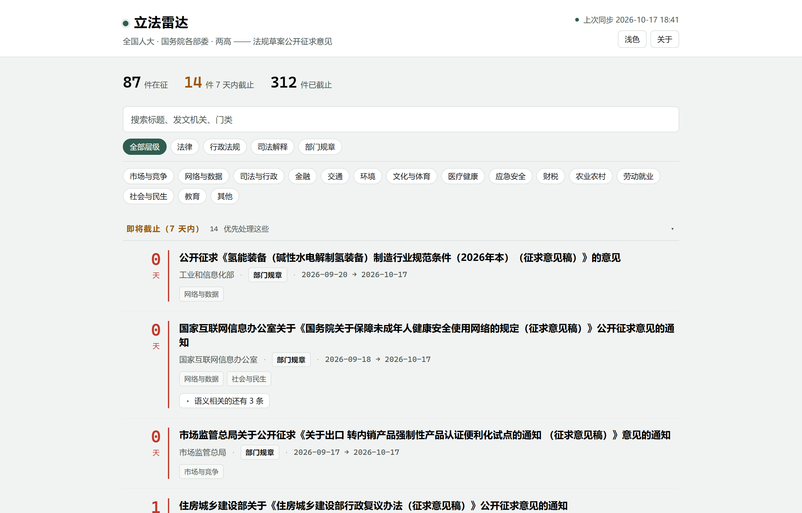

# 立法雷达 LegisRadar

立法雷达汇总全国人大和国务院各部委公开征求意见的法规草案。
法规草案公开征求意见，是我国社会主义民主政治的一项制度安排。
本项目帮助公众了解这些信息，方便公众**依法有序参与**。
读者打开看板，看到条目列表。
每条显示标题、发文机关和截止日期。
读者点击标题，浏览器打开官网原文。
看板定期更新。

## 它是什么

- **一个本地看板。** 读者双击启动，不需安装第三方库。
- **断网也能看。** 程序自带一份索引，断网时直接使用。
- **只显示元数据。** 包括标题、机关、位阶、日期和官方链接。
- **只做跳转，不转载正文。** 每条都带官网原文链接，读者到官网阅读和核对。
- **只汇总，不评价。** 本项目不对草案内容表达观点，也不引导读者立场。
- **不替读者提交意见。** 读者自己决定是否提交，以及如何提交。

## 怎么用

1. 安装 Python 3.11 或更新版本。
   下载地址：<https://www.python.org/downloads/>
   安装时选中 **Add Python to PATH**。
2. 双击 **`启动.bat`**。
   macOS 或 Linux 用户运行 `./start.sh`。
3. 浏览器自动打开看板。

程序第一次运行时联网，下载最新索引；之后每次启动都会更新索引。
看板不会自动刷新。读者再次双击启动脚本，看板才更新。

「不再关注」按钮需要本地服务，启动脚本会启动它。
读者直接双击 `board.html` 时，按钮不工作。

## 它不是什么

- 它不是网站。它没有账号，也不上传数据。
- 它不下载正文。它不保存联系方式。它不提交意见。
- 它不是官方网站。读者提交意见，请到官网办理。

## 数据从哪来

条目来自各机关官网公开发布的征求意见公告。
维护者定期汇总公告，并发布索引。
索引只含元数据，不含正文。
条目可能与官网不一致，也可能有遗漏或延迟。日期和内容以官网原文为准。
本项目整理这些公开信息，服务政务公开和公众参与。

## 许可

Apache-2.0。见 [LICENSE](LICENSE) 和 [NOTICE](NOTICE)。
